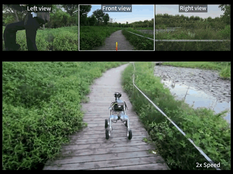
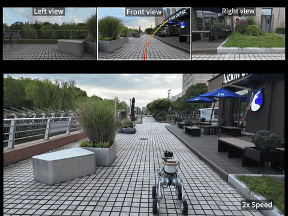
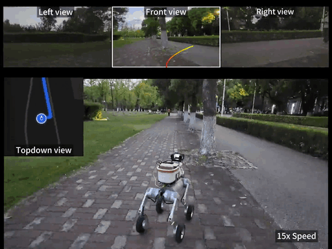

<div align="center">

# OpenXNav

### Towards Generalist Embodied Navigation

**One System, Many Navigation Tasks.**

Han Zheng · Zhe Chen · Yijian Li · Ming Yang · Tong Qin

**Shanghai Jiao Tong University**

[](https://wuyi2121.github.io/UrbanAgent/)
[](https://wuyi2121.github.io/UrbanAgent/#agent)


</div>

<div align="justify">

## 🌍 What is OpenXNav?

OpenXNav is a generalist embodied navigation system in the open world, with four core highlights:

- **Open Semantics:** Enable natural human-robot interaction through open-vocabulary understanding and flexible multimodal instructions.
- **Unified Navigation:** Unify object search, instruction following, target tracking, social navigation, POI navigation, urban navigation and other tasks across indoor and outdoor environments.
- **Accessible Deployment:** Provide an open-source, modular framework for easy deployment across different robotic embodiments in open world.
- **Continuous Evolution:** Continuously benefit from advances in foundation models, navigation policies, and robot control.

<p align="center">
  
</p>

## 🧭 OpenXNav · v0.1

- **UrbanAgent:** A Zero-Shot Agentic System for Long-Horizon Urban Navigation.
- **First milestone:** OpenXNav v0.1 explores generalist embodied navigation in real-world urban environments.
- **Core approach:** Combine vision-language models, digital map tools, and real-time navigation.

<!-- GIF excerpts from https://wuyi2121.github.io/UrbanAgent/video/:
     Regenerate with: python3 scripts/generate_demo_gifs.py
     long/coffee.mp4: 00:08–00:15.5, played at 1.5× source speed.
     semantic/semantic1_final.mp4: 00:08–00:13.
     poi/luckin/luckin1_final.mp4: 00:07–00:12.
     long/long_final.mp4: 00:20–00:25.
-->
<table>
  <tr>
    <th width="50%" align="center">🧠 Agentic Navigation</th>
    <th width="50%" align="center">👀 Vision-Language Navigation</th>
  </tr>
  <tr>
    <td width="50%" align="center" valign="top">
      <p><a href="https://wuyi2121.github.io/UrbanAgent/#agent"></a></p>
      <p>Understand instructions and execute tasks with tools.</p>
      <a href="https://wuyi2121.github.io/UrbanAgent/#agent"><sub>Watch demo ↗</sub></a>
    </td>
    <td width="50%" align="center" valign="top">
      <p><a href="https://wuyi2121.github.io/UrbanAgent/#vln"></a></p>
      <p>Follow sidewalks with language and visual cues.</p>
      <a href="https://wuyi2121.github.io/UrbanAgent/#vln"><sub>Watch demo ↗</sub></a>
    </td>
  </tr>
  <tr>
    <th width="50%" align="center">📍 Point-of-Interest Navigation</th>
    <th width="50%" align="center">🗺️ Long-Horizon Urban Navigation</th>
  </tr>
  <tr>
    <td width="50%" align="center" valign="top">
      <p><a href="https://wuyi2121.github.io/UrbanAgent/#poinav"></a></p>
      <p>Locate storefronts and navigate to their entrances.</p>
      <a href="https://wuyi2121.github.io/UrbanAgent/#poinav"><sub>Watch demo ↗</sub></a>
    </td>
    <td width="50%" align="center" valign="top">
      <p><a href="https://wuyi2121.github.io/UrbanAgent/#amap"></a></p>
      <p>Follow kilometer-scale routes with digital map guidance.</p>
      <a href="https://wuyi2121.github.io/UrbanAgent/#amap"><sub>Watch demo ↗</sub></a>
    </td>
  </tr>
</table>

<p align="center">
  <a href="https://wuyi2121.github.io/UrbanAgent/"><strong>Explore UrbanAgent &amp; Watch Real-World Demos →</strong></a>
</p>

## 🚀 Roadmap

- [x] v0.1 — UrbanAgent: Long-Horizon Urban Navigation.
- [ ] v1.0 — OpenXNav: Generalist Embodied Navigation.
- [ ] Full Open-Source Release.

## 📖 Citation

If you find this work useful in your research, please cite:

```bibtex
@misc{zheng2026urbanagent,
  author = {Zheng, Han and Chen, Zhe and Li, Yijian
            and Yang, Ming and Qin, Tong},
  title  = {{UrbanAgent}: A Zero-Shot Agentic System
            for Long-Horizon Urban Navigation},
  year   = {2026},
  url    = {https://wuyi2121.github.io/UrbanAgent/},
  note   = {Project page}
}
```

</div>

---

<p align="center"><sub>Star or watch this repository for future updates and releases.</sub></p>
